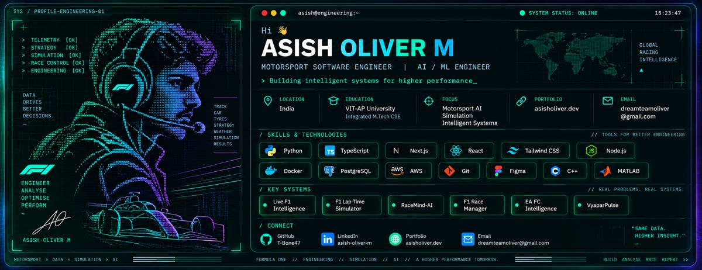

<!--
ASISH OLIVER M | Engineering portfolio README
Theme: charcoal / McLaren-inspired orange / electric blue.
Third-party widgets are progressive enhancements; core content remains readable without them.
-->

<p align="center">
  
</p>

<p align="center">
  
</p>

<p align="center">
  <a href="https://github.com/T-Bone47"></a>
  <a href="https://www.linkedin.com/in/asish-oliver-56b454324"></a>
  <a href="mailto:dreamteamoliver@gmail.com"></a>
</p>

<p align="center">
  
</p>

<h2 align="center">ENGINEERING INTELLIGENCE, NOT JUST INTERFACES</h2>

<p align="center">
  I build software where <strong>real data, validated models, simulation and AI</strong> come together to support better engineering decisions.
</p>

<p align="center">
  <code>MOTORSPORT</code> &nbsp; <code>TELEMETRY</code> &nbsp; <code>AI / ML</code> &nbsp; <code>SIMULATION</code> &nbsp; <code>SPORTS INTELLIGENCE</code>
</p>

---

## ◈ Mission Control

<table>
  <tr>
    <td width="25%" align="center"><strong>01</strong><br/><sub>INGEST</sub><br/>Reliable data</td>
    <td width="25%" align="center"><strong>02</strong><br/><sub>MODEL</sub><br/>Explainable logic</td>
    <td width="25%" align="center"><strong>03</strong><br/><sub>VALIDATE</sub><br/>Tests and replay</td>
    <td width="25%" align="center"><strong>04</strong><br/><sub>DECIDE</sub><br/>Useful intelligence</td>
  </tr>
</table>

```text
DATA STREAM  ──►  FEATURE / PHYSICS MODELS  ──►  VALIDATION
     ▲                                                │
     └────────────── REPLAY + OBSERVABILITY ◄─────────┘
                              │
                              ▼
                    ENGINEERING DECISIONS
```

## ◈ Flagship Systems

<table>
  <tr>
    <td width="50%" valign="top">
      <h3>🏁 <a href="https://github.com/T-Bone47/live-f1-intelligence">LIVE F1 INTELLIGENCE</a></h3>
      <p><strong>Real-time motorsport data platform</strong></p>
      Canonical event ingestion, provider abstraction, replayable pipelines, telemetry analysis and deterministic race-intelligence primitives.
      <p><sub>Python · FastAPI · Telemetry · Replay · Data Engineering</sub></p>
      <a href="https://github.com/T-Bone47/live-f1-intelligence">Explore repository →</a>
    </td>
    <td width="50%" valign="top">
      <h3>🎧 <a href="https://github.com/T-Bone47/RaceMind-AI">RACEMIND AI</a></h3>
      <p><strong>AI-assisted race engineering</strong></p>
      A race-engineering platform exploring telemetry-aware strategy reasoning, driver coaching and session intelligence.
      <p><sub>Python · FastAPI · PostgreSQL · WebSockets · AI</sub></p>
      <a href="https://github.com/T-Bone47/RaceMind-AI">Explore repository →</a>
    </td>
  </tr>
  <tr>
    <td width="50%" valign="top">
      <h3>📐 <a href="https://github.com/T-Bone47/f1-pro-simulator-">F1 LAP-TIME SIMULATOR</a></h3>
      <p><strong>Numerical vehicle-performance modelling</strong></p>
      Simulation work spanning track modelling, corner speed, grip constraints, aero effects and numerical validation.
      <p><sub>MATLAB · Python · NumPy · Vehicle Dynamics</sub></p>
      <a href="https://github.com/T-Bone47/f1-pro-simulator-">Explore repository →</a>
    </td>
    <td width="50%" valign="top">
      <h3>⚽ <a href="https://github.com/T-Bone47/EA_FC_INTELLIGENCE">EA FC INTELLIGENCE</a></h3>
      <p><strong>Player data and recommendation intelligence</strong></p>
      An EA FC project focused on structured player data, feature engineering, ranking and recommendation workflows.
      <p><sub>Python · Pandas · NumPy · Scikit-learn</sub></p>
      <a href="https://github.com/T-Bone47/EA_FC_INTELLIGENCE">Explore repository →</a>
    </td>
  </tr>
  <tr>
    <td width="50%" valign="top">
      <h3>📊 <a href="https://github.com/T-Bone47/Football_OS">FOOTBALL INTELLIGENCE OS</a></h3>
      <p><strong>Football decision-support platform</strong></p>
      Recruitment, player valuation, tactical analysis and football intelligence workflows.
      <p><sub>Analytics · Data Engineering · AI Systems</sub></p>
      <a href="https://github.com/T-Bone47/Football_OS">Explore repository →</a>
    </td>
    <td width="50%" valign="top">
      <h3>📈 <a href="https://github.com/T-Bone47/vyaparpulse-ai">VYAPARPULSE AI</a></h3>
      <p><strong>Financial intelligence for micro-businesses</strong></p>
      Structured transaction capture, ledger workflows and revenue forecasting for business decision support.
      <p><sub>React · FastAPI · SQLAlchemy · XGBoost</sub></p>
      <a href="https://github.com/T-Bone47/vyaparpulse-ai">Explore repository →</a>
    </td>
  </tr>
</table>

<p align="center">
  <strong>ALSO IN THE WORKSHOP</strong><br/>
  <a href="https://github.com/T-Bone47/race-manager">F1 Race Manager</a> ·
  <a href="https://github.com/T-Bone47/IGNICT">IGNICT</a> ·
  <a href="https://github.com/T-Bone47/asish-portfolio">Portfolio Website</a>
</p>

---

## ◈ Technical Arsenal

<p align="center">
  
</p>

<table>
  <tr><td><strong>AI / ML & Data</strong></td><td>Pandas · NumPy · Scikit-learn · XGBoost · Feature Engineering · Ranking & Recommendation · LLM Integration</td></tr>
  <tr><td><strong>Backend & Systems</strong></td><td>FastAPI · PostgreSQL · SQLite · SQLAlchemy · WebSockets · Docker · Pytest · Replayable Pipelines</td></tr>
  <tr><td><strong>Motorsport</strong></td><td>FastF1 · OpenF1 · UDP Telemetry · Lap/Sector Analysis · Tyre Degradation · Race Strategy</td></tr>
  <tr><td><strong>Simulation</strong></td><td>MATLAB · NumPy · Vehicle Dynamics · Unity · C# · Numerical Validation</td></tr>
</table>

---

## ◈ GitHub Telemetry

<p align="center">
  
  
</p>

<p align="center">
  
</p>

<p align="center">
  
</p>

<p align="center">
  
</p>

<details>
  <summary><strong>🧬 Profile metrics philosophy</strong></summary>
  <br/>
  Numbers and activity cards are dynamic third-party widgets and may occasionally be unavailable. I prioritize reproducible project outcomes, tests, and transparent engineering notes over vanity metrics.
</details>

---

## ◈ Engineering Principles

- **Measure before claiming.** Performance claims should be reproducible.
- **Validate before inference.** AI should be grounded in reliable context.
- **Explain assumptions.** Models must be inspectable and testable.
- **Design for failure.** Validation, tests and replay belong in the system.
- **Optimize for decisions.** The best output helps someone act with confidence.

## ◈ Current Build Queue

```text
[LIVE]   Live F1 Intelligence  -> telemetry pipelines + deterministic analysis
[BUILD]  F1 Simulation         -> vehicle performance + numerical validation
[BUILD]  EA FC Intelligence    -> player intelligence + recommendations
[BUILD]  Football OS           -> recruitment + valuation + tactical analysis
[BUILD]  IGNICT                -> applicant / opportunity matching
```

---

<p align="center">
  
</p>

<p align="center">
  <strong>BUILD • MEASURE • VALIDATE • ITERATE</strong><br/>
  <sub>DATA → MODELS → SYSTEMS → SIMULATION → INTELLIGENCE → DECISIONS</sub>
</p>
