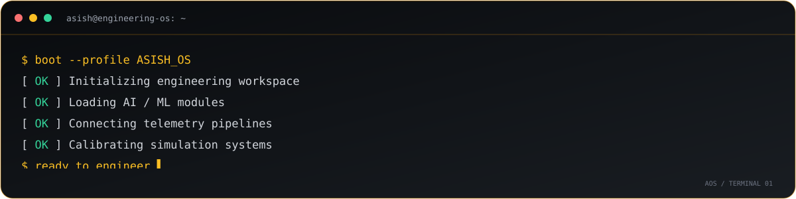
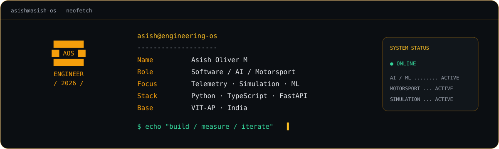
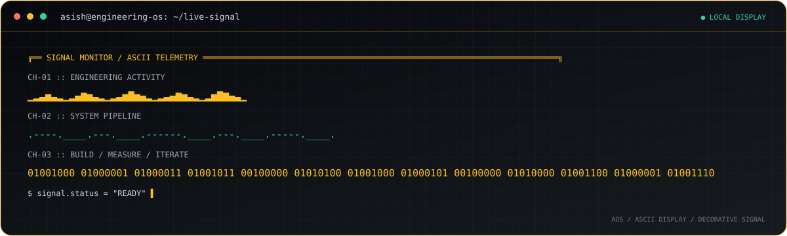
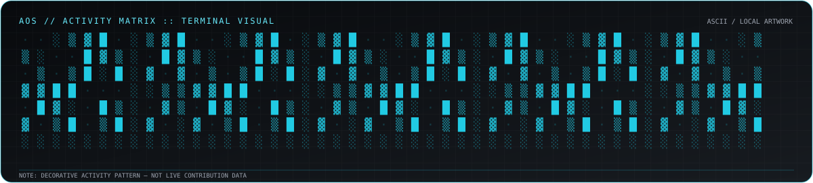
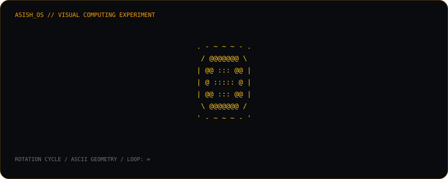

<!-- ASISH ENGINEERING PROFILE / SIGNAL-FIRST EDITION -->

  
  
<strong>Building systems that turn complex data into practical engineering tools.</strong>

  
AI/ML · Motorsport software · Real-time data · Simulation · Full-stack engineering

  

    <a href="https://asish-os.vercel.app/">ASISH OS — Engineering Workspace</a> ·
    <a href="https://github.com/T-Bone47/Minecraft-folio">Minecraft Engineering Frontier</a> ·
    <a href="https://www.linkedin.com/in/asish-oliver-56b454324">LinkedIn</a> ·
    <a href="mailto:dreamteamoliver@gmail.com">Contact</a>
  

---

## 01 / ENGINEER PROFILE

I'm **Asish Oliver M**, an **Integrated M.Tech Computer Science and Engineering student at VIT-AP**. I work at the intersection of **motorsport software, real-time systems, applied machine learning and full-stack products**.

I enjoy taking a problem from architecture and data modelling through implementation, testing and a usable interface. My work spans telemetry ingestion, race analysis, backend APIs, numerical simulation and AI-assisted applications.

| Focus area | Engineering work |
|---|---|
| **Motorsport + simulation** | Race telemetry, strategy analysis, lap-time and performance modelling |
| **Data + backend systems** | Event ingestion, APIs, databases, streaming, reproducible tests |
| **AI + machine learning** | Forecasting, retrieval, model evaluation and intelligent workflows |
| **Product + creative engineering** | Full-stack tools, visualisations and interactive 3D experiences |

## 02 / FEATURED ENGINEERING WORK

Real repositories and technical work, presented by what each system demonstrates. Project maturity and measurable results belong in the linked repositories, not in unsupported profile badges.

| Project | What it demonstrates | Domain |
|---|---|---|
| **[Live F1 Intelligence](https://github.com/T-Bone47/live-f1-intelligence)** | Race data ingestion, canonical events, session recording/replay and telemetry analysis | Motorsport · Data |
| **[RaceMind AI](https://github.com/T-Bone47/RaceMind-AI)** | Game telemetry processing, race-engineering intelligence and strategy tooling | Motorsport · Software |
| **[VyaparPulse AI](https://github.com/T-Bone47/vyaparpulse-ai)** | Voice-first merchant workflows, reconciliation and ML-assisted forecasting | Applied AI · Product |
| **[Sentinel AI](https://github.com/T-Bone47/Sentinel-AI)** | Governance, risk and compliance intelligence with explainable decisions | AI · Security |
| **[Football Intelligence OS](https://github.com/T-Bone47/Football_OS)** | Football intelligence and sports-data experimentation | Sports · Analytics |

<strong>▸ EXPAND / ORIGINAL ASCII PROJECT GALLERY</strong> — animated visual modules for the featured systems

## 03 / TWO WAYS TO EXPLORE MY WORK

| **ASISH OS — Professional engineering workspace** | **Engineering Frontier — Playable voxel portfolio** |
|---|---|
| Desktop-inspired technical portfolio with project case studies and engineering interfaces. | Minecraft-inspired 3D engineering campus with motorsport and software exhibits. |
| **[Open the live workspace](https://asish-os.vercel.app/)** | **[Explore the source repository](https://github.com/T-Bone47/Minecraft-folio)** |

These are **two separate portfolio projects** with different design identities. The Minecraft-folio link currently points to its repository; it is not presented as a verified live deployment.

## 04 / ENGINEERING TOOLCHAIN

| Area | Tools |
|---|---|
| **Languages** | Python · TypeScript · JavaScript · Java · C++ · SQL |
| **Frontend + 3D** | React · Next.js · Three.js · React Three Fiber |
| **Backend + data** | FastAPI · Node.js · PostgreSQL · TimescaleDB · WebSockets |
| **ML + numerical** | scikit-learn · XGBoost · NumPy · Pandas |
| **Workflow** | Git · Docker · automated tests · reproducible experiments |

**Engineering habits:** observe → model → implement → validate → improve. I prefer verifiable results and clear technical trade-offs over inflated metrics.

<strong>▸ EXPAND / ENGINEERING ARCHITECTURE & VALIDATION NOTES</strong>

The Live F1 figures are repository-reported measurements from a recorded test scenario, not independently verified production guarantees. [Inspect the project and validation notes](https://github.com/T-Bone47/live-f1-intelligence).

## 05 / MORE PROJECTS

[IGNICT](https://github.com/T-Bone47/IGNICT) ·
[DeliveryHub](https://github.com/T-Bone47/DeliveryHub) ·
[Race Manager](https://github.com/T-Bone47/race-manager) ·
[RACEWISE](https://github.com/T-Bone47/RACEWISE) ·
[F1 Pro Simulator](https://github.com/T-Bone47/f1-pro-simulator-) ·
[EA FC Intelligence](https://github.com/T-Bone47/EA_FC_INTELLIGENCE) ·
[PES06Remastered](https://github.com/T-Bone47/PES06Remastered)

Explore the [complete repository list](https://github.com/T-Bone47?tab=repositories) for source and current project status.

## 06 / SIGNAL LAB

<strong>▸ EXPAND / ASISH OS TERMINAL ANIMATIONS</strong> — original ASCII-inspired visuals

The console and heatmap are **illustrations**, not live activity or performance measurements. The contribution snake is generated by this repository's GitHub Actions workflow.

---

## 07 / CONNECT

Interested in **motorsport engineering, AI/ML, backend systems, developer tools and technically ambitious collaborations**.

**[LinkedIn](https://www.linkedin.com/in/asish-oliver-56b454324)** · **[Email](mailto:dreamteamoliver@gmail.com)** · **[ASISH OS](https://asish-os.vercel.app/)** · **[GitHub repositories](https://github.com/T-Bone47?tab=repositories)**

ASISH OLIVER M · VIT-AP · ENGINEERING SYSTEMS

