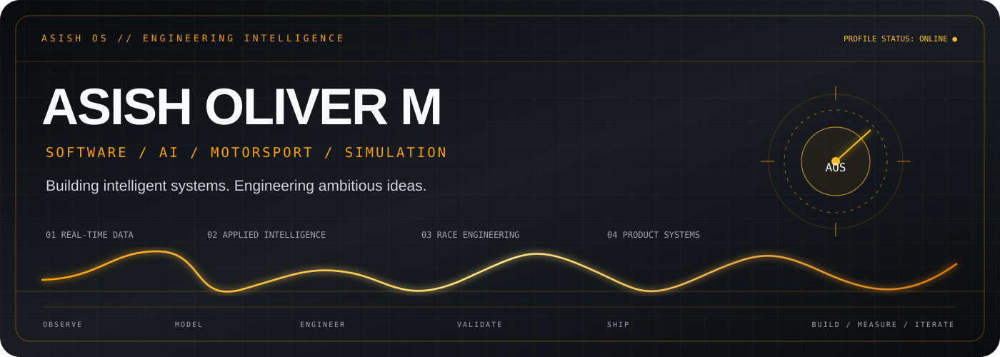
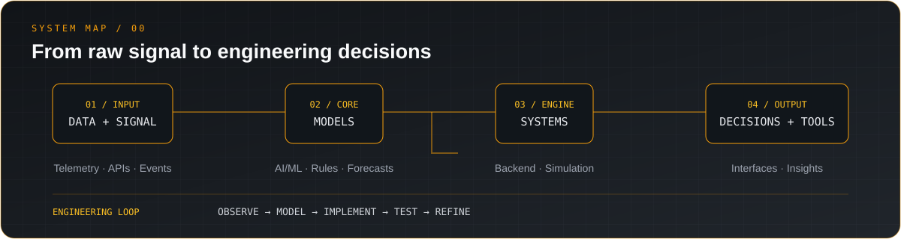
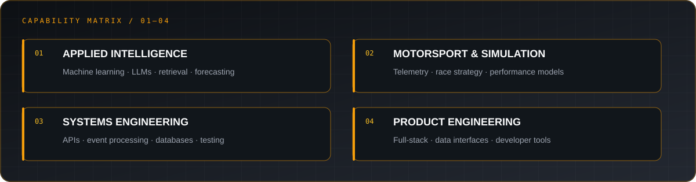
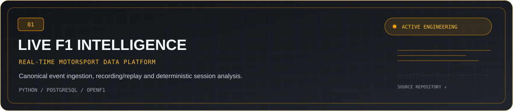
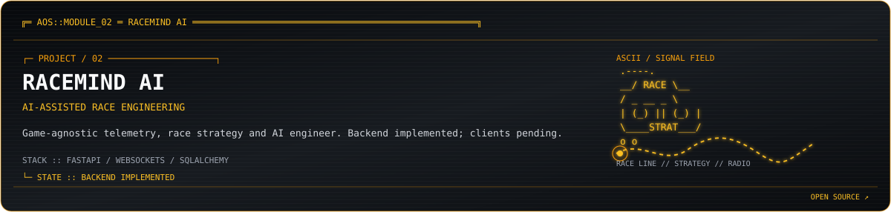
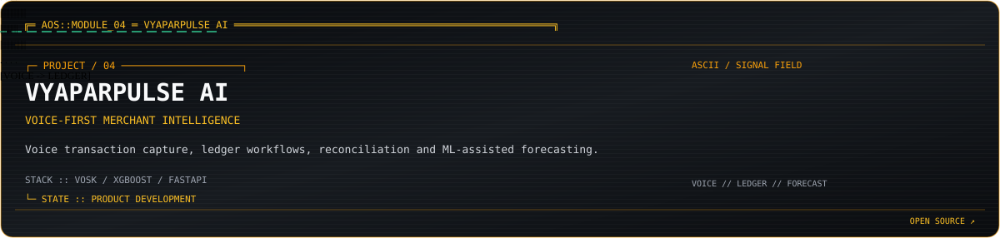
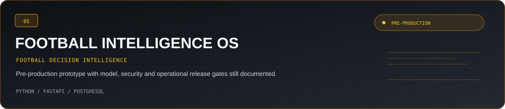
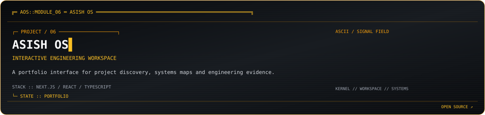
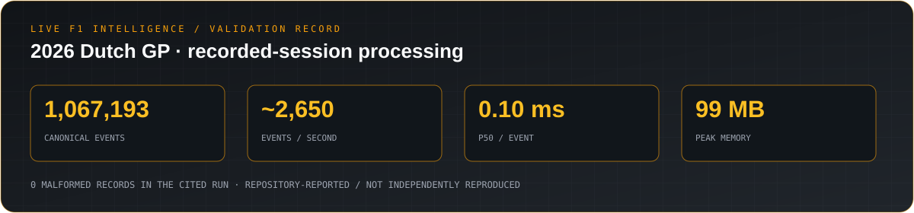
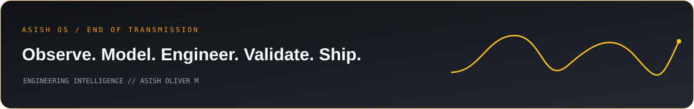

<!-- ASISH OS / PERSONAL ENGINEERING INTERFACE -->

**I build systems that turn complex data and ideas into working engineering tools.**

AI / ML · Motorsport technology · Simulation · Software engineering

---

## 01 / THE ENGINEER

I'm **Asish Oliver M**, an Integrated M.Tech Computer Science student at **VIT-AP**. I work across AI/ML, backend systems, real-time data, motorsport software, simulation and full-stack product engineering.

My interest is in the engineering underneath the interface: understanding a complex problem, modelling it, building the system, measuring its behaviour and making the result reliable. I care about clear architecture, data integrity, reproducible tests and honest project status.

**Current focus** — real-time engineering intelligence, AI-assisted workflows, telemetry systems and simulation.

## 02 / SELECTED SYSTEMS

Six projects. Six different engineering problems. Every panel links to its source.

## 03 / ENGINEERING EVIDENCE

These figures are repository-reported measurements from one recorded 2026 Dutch GP session—not independent benchmarks or universal production guarantees. [Inspect the implementation and validation notes](https://github.com/T-Bone47/live-f1-intelligence).

## 04 / TECHNOLOGY

**Engineering practice** — API design · event-driven systems · telemetry processing · numerical modelling · ML pipelines · data visualisation · test automation · observability.

## 05 / DEVELOPMENT SIGNAL

<picture><source media="(prefers-color-scheme: dark)" srcset="https://raw.githubusercontent.com/T-Bone47/T-Bone47/snake/github-snake-dark.svg"/><source media="(prefers-color-scheme: light)" srcset="https://raw.githubusercontent.com/T-Bone47/T-Bone47/snake/github-snake.svg"/></picture>

Third-party activity cards may be delayed or temporarily unavailable. They are decorative indicators, not engineering evidence.

## 06 / OTHER BUILDS

[IGNICT](https://github.com/T-Bone47/IGNICT) · [DeliveryHub](https://github.com/T-Bone47/DeliveryHub) · [Race Manager](https://github.com/T-Bone47/race-manager) · [RACEWISE](https://github.com/T-Bone47/RACEWISE) · [F1 Pro Simulator](https://github.com/T-Bone47/f1-pro-simulator-) · [EA FC Intelligence](https://github.com/T-Bone47/EA_FC_INTELLIGENCE) · [PES06Remastered](https://github.com/T-Bone47/PES06Remastered) · [Minecraft-folio](https://github.com/T-Bone47/Minecraft-folio)

Outside software, I'm interested in Formula 1, vehicle performance, racing simulations, football analytics and game development. Those interests often become engineering experiments.

---

**Open to conversations around motorsport software, performance engineering, AI/ML and ambitious software systems.**
ASISH OLIVER M · VIT-AP · ENGINEERING SYSTEMS / 2026

